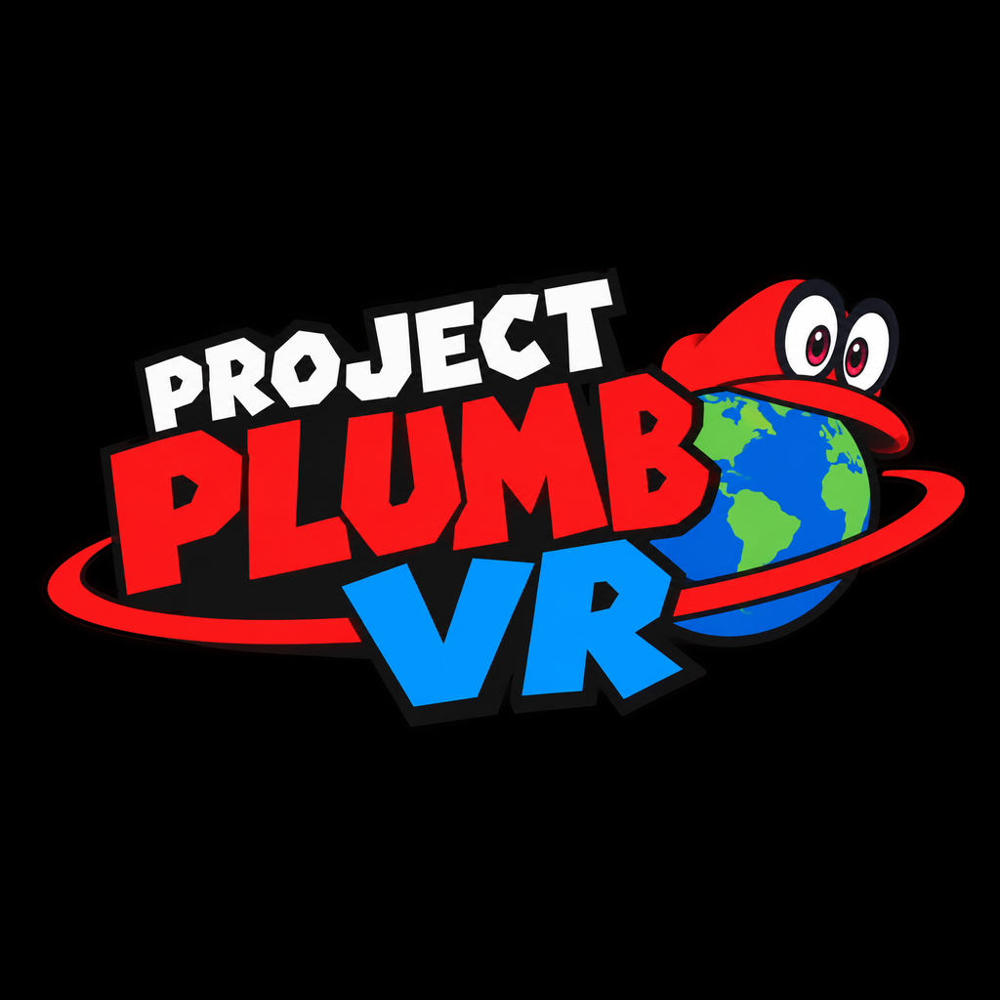

# Project Plumb VR

[](https://discord.gg/XUtAtkdumP)
[](docs/DEMO_PROGRESS.md)
[](https://recompendium.com/en/port/super-mario-odyssey-project-plumb-vr/)

> **Bringing the Odyssey into another dimension.**
>
> A native Super Mario Odyssey VR port for Meta Quest 3 and Quest 3S.



## What this is

I'm White. I started this because I wanted to actually be Mario in VR, not watch him on a flat screen.

Project Plumb VR is a fan port of **Super Mario Odyssey (version 1.0.0)** for the **Meta Quest 3 and Quest 3S**. It's a standalone **Android ARM64 OpenXR APK**. No PC. No WebXR. No browser game. No streaming a flat game into a headset.

The idea is simple. Look down, see Mario's overalls. Reach out, your hands are his white gloves. Throw Cappy with a real throw. The Quest 3 and 3S do the tracking themselves, inside out, no base stations. Both headsets run the same chip, Snapdragon XR2 Gen 2, so the same APK should run on both.

This is not Nintendo's Labo VR. That came in update 1.3.0 and it's only three small side missions. SMO 1.0.0 has no VR in it at all. So the stereo rendering, the head tracked camera, 6DoF, the Touch controllers, all of it has to be built from scratch. The hard part is the game logic. It runs at 60 steps a second, and VR needs to run faster than that. Splitting those two apart is the core problem here.

## Demo scope

The first playable slice is both parts together. Not one or the other, both.

**Part 1, the opening.** Bowser's airship, the fight, Mario gets knocked off, he falls, then he meets Cappy in Cap Kingdom.

**Part 2, the wedding.** You crash Bowser's wedding, then it's Cap Kingdom again, and the demo ends after you beat **Topper**.

Topper makes sense as the end point. He takes 2 hits, which is the only Broodal fight that needs 2. He doesn't give a Power Moon. Beating him opens the Spark pylon onward. And Cap Kingdom has 0 Power Moons you can grab on a first visit, so the payoff here is unlocking the next kingdom, not a moon count.

## The long term goal

Once the game is fully decompiled, I want the whole thing in VR. All of it, like in the Nintendo Switch Presentation 2017 trailer (<https://www.youtube.com/watch?v=5kcdRBHM7kM>). All 17 kingdoms, all 880 Power Moons, all 52 captures.

That's a long way off. The demo comes first.

## How it should play

**Camera.** Third person VR most of the time, Mario in view, and you can look around on your own. You can change the distance and height, use smooth turning or snap turning, recenter whenever, and turn on a comfort vignette if you want it. Nothing should force your view around. No sudden spins.

**Captures change the camera.** It depends what you're controlling. **T-Rex is first person. Sherm, the tank, is first person.** Everything else stays third person.

**Being Mario.** First person where it fits, hands are Mario's gloves, inside out body tracking.

**Performance.** 72 FPS minimum on a standalone Quest 3 and Quest 3S. Higher refresh rates later, if I can get them.

**Controls, planned:**

Cappy is not a button press to throw him. You move your hand, grab him with the grip button, and throw him by letting go of the grip in a throw motion. Reach out and your hand is Mario's glove, hold grip to grab Cappy off Mario's head, throw your arm, release grip, and Cappy flies where you threw him. In the real build, after a throw Cappy stays in the air, rises slightly, then returns to your head. The demo's quick boomerang return is just a stand-in for that.

| Controller | Input | Action |
|---|---|---|
| Left | Thumbstick | Move Mario |
| Left | X | Secondary action |
| Left | Y | Menu |
| Right | Thumbstick | Camera |
| Right | A | Jump |
| Right | B | Secondary action |
| Right | Grip (hold) | Grab Cappy |
| Right | Grip (release in throw motion) | Throw Cappy |
| Either | Grip | Contextual interaction when not holding Cappy |

## Where things stand

Be honest about this. It's early.

**There is no playable demo yet.** But there are test APKs running on a Quest 3 now, and they have come a long way since v0.12. The latest one, **v0.33.4-hotfix** (versionCode 37, 6,775,544 bytes, SHA-256 `c45c2d05a647d9633d8145b671e0da0d57f7e9f292ad8dc5ec093a7f6d263a59`, delivered 2026-11-10), has Mario in first person with his real glove models on the controllers, a connected body and arms, and Cappy thrown with the real decompiled HackCap throw logic: grip to grab, real release velocity to throw, lock-on to a capturable target, and return to the head. The peach-fill bug from v0.33 is fixed, and the glove orientation fix in v0.33.4 is the one being Quest-tested now. Still no video, no music, no textures yet in the app (the real Mario textures are decoded and queued for v0.34), and the eye-shape work is queued for v0.35.

**Demo decomp is at 49.9%: 1,266 / 2,535 functions matched** as of 2026-11-11. Topper is 147/179, Cappy is 146/189, NPCs are 226/252, Bowser is the big blocker at 348/1,147. Full breakdown in [`docs/DEMO_PROGRESS.md`](docs/DEMO_PROGRESS.md). The badge at the top of this page shows the same number, and it updates as decomp lands. The whole game decomp is at 20,679 / 74,171 (27.9%) at the same time.

As of 2026-11-11:

- Toolchain done. OpenXR SDK 1.1.65, Gradle 8.14.3, Temurin JDK 17.0.21, Android SDK with NDK r27c, durable ninja 1.13.1 and ccache 4.10.2.
- The NSP is done. The Super Mario Odyssey 1.0.0 NSP finished downloading 2026-11-09 around 11:08, verified at 5,611,009,601 bytes exactly, PFS0 header, 8 files inside. It's not in this repo and it never will be.
- NSO extracted and the decomp setup done. `tools/build.py` and `tools/check` pass on the local clone.
- RomFS extracted, 4,636 files. Mario's model, gloves and body converted from the ROM. The real SMO menu extracted. Cap Kingdom ground partly converted. All 51 audio banks unpacked, 7,231 audio files catalogued, and a full-game reference written from the full walkthrough.
- Test APKs v0.6 through v0.33.4 built and Quest-tested in stages. The foundation app in this repo (`vr-foundation/`) is an early snapshot, v0.1, not the current test build. The current test builds are delivered to testers directly, not published here.
- Next milestone after 50% is 80% of the demo: 2,028 / 2,535 functions.

The decomp is the long pole. The 2026-09-29 snapshot has source for about 19% of the game's object files by file count, 597 of 3,126 `.o` entries. The published numbers don't agree with each other, so I'm not picking one and calling it the truth. The project's own page said 25.611% matching on 2026-11-09. Other trackers said 15.77% on 2026-10-26 and 16% on 2026-11-06. Different dates, different ways of counting. And a decomp build that works still isn't a playable game. The missing systems have to be decompiled or written from scratch for the demo slice.

## OdysseyDecomp

This project is not OdysseyDecomp, and it doesn't copy OdysseyDecomp's code in. OdysseyDecomp (<https://github.com/MonsterDruide1/OdysseyDecomp>) is its own thing, its own team, a work in progress decomp of SMO 1.0.0. I use it as a reference and a dependency, through a git submodule or a fresh clone, and I build my own VR host, renderer, input, and camera code on top of the decompiled logic where it exists.

One thing to know. At the time of writing, OdysseyDecomp has **no LICENSE file**. That means its code is all rights reserved by default, even though it's public on GitHub. So don't copy its files into this repo. If that changes upstream, this note needs updating.

Other projects in the same space, none of them mine: **Power Moon Recomp** (static recomp of 1.0.0 for PC) and **smo-recomp** (a separate 1.4.1 recomp project), plus **Power Moon VR** (an OpenXR overlay for Power Moon Recomp). Plumb is a native Quest port. Not an overlay, not a recomp.

## What you need to build it (not included)

You have to bring your own legally dumped copy. **None of this is in the repo, and none of it ever will be:**

- Super Mario Odyssey **1.0.0**, dumped from your own Switch. The main NSO from its ExeFS is what the decomp setup needs. RomFS assets are needed for a playable game.
- Your `prod.keys`, only for extracting your own dump.
- Any `.nsp`, `.nso`, `.xci`, RomFS files, game models, audio, or textures.

Check [`.gitignore`](.gitignore). All of that is excluded. Anything with that stuff in it gets rejected.

## Building (early days)

Full instructions are in [`docs/BUILD_INSTRUCTIONS.md`](docs/BUILD_INSTRUCTIONS.md). Short version, once the toolchain is in:

```bash
# 1. Clone with submodules (do NOT use a bare zip extract)
git clone --recursive https://github.com/MonsterDruide1/OdysseyDecomp
# (in the Plumb repo, OdysseyDecomp is a submodule, see docs)

# 2. Extract your own 1.0.0 main NSO from your own dump, then:
tools/setup.py [path to your main NSO]
tools/build.py
tools/check
```

That only checks the decomp. It doesn't make a playable game. The Android and OpenXR build steps still need writing. Put durable tools under `~/workspace/`, not `/usr`, `/opt`, or `/tmp`. See [`docs/PROJECT_STATUS.md`](docs/PROJECT_STATUS.md) and [`docs/BLOCKERS.md`](docs/BLOCKERS.md) for the environment audit and what's still blocked.

APK signing is an end of demo step only for the real release key. The test APKs are debug-signed with a test key and delivered to testers directly, they are not published in this repo.

## Contributing

See [CONTRIBUTING.md](CONTRIBUTING.md). Short version: your own code and docs only, no Nintendo assets, no keys, no dumps. Decomp work goes upstream to OdysseyDecomp, not here. The help I actually need is VR and host code, rendering, input, camera, builds, and testing.

## License

The original code and docs in this repo are under the MIT License. See [LICENSE](LICENSE). **That license only covers Project Plumb VR's own work.** It doesn't cover Nintendo's game, assets, or code, and it doesn't cover OdysseyDecomp's code. MIT, picked 2026-11-09, copyright holder Project Plumb VR. There's more on why MIT in [LICENSE-CHOICE.md](LICENSE-CHOICE.md).

## Legal

Project Plumb VR is an unofficial fan project. It's not affiliated with Nintendo, not endorsed by them, not connected to them. Super Mario Odyssey, Mario, Cappy, and all the related characters and assets are Nintendo's trademarks and copyrights. This repo has no Nintendo code, assets, or game files in it. You need your own legally obtained copy of the game to build or play anything from this project.

## Thanks

- The OdysseyDecomp team, for the decomp this is built on
- The SMO modding and decomp community
- White, project founder, Quest 3, no PC, doing it anyway
